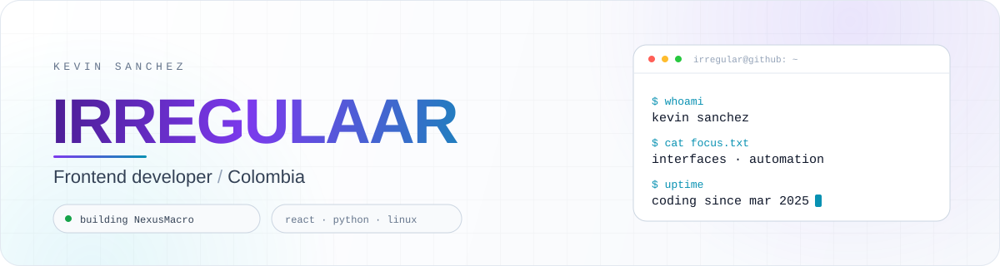
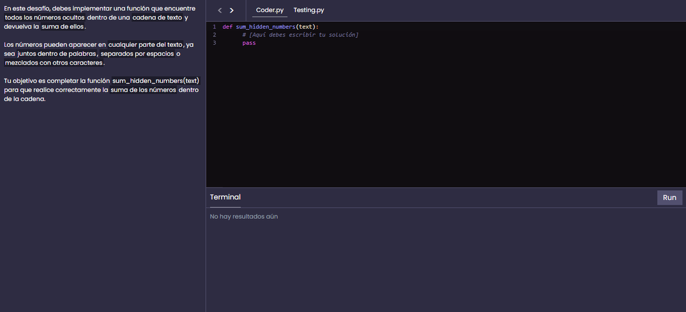

<picture>
  <source media="(prefers-color-scheme: dark)" srcset="./assets/hero-dark.svg">
  <source media="(prefers-color-scheme: light)" srcset="./assets/hero-light.svg">
  
</picture>

## `$ whoami`

Hola, soy **Kevin Sanchez** — **Irregular** en internet. Soy de Colombia y desde **marzo de 2025** estoy metido de lleno en el desarrollo web. Ya sabía algo de programación, pero el frontend me atrapó por la parte visual y el detalle. Todavía estoy aprendiendo, y me gusta cada vez más.

Cuando no estoy peleándome con CSS, estoy automatizando cosas en Linux, mirando cómo funciona Wayland o construyendo proyectos que probablemente nadie me pidió.

## ⚡ Ahora

- 🔭 **Construyendo** proyectos pequeños y aprendiendo en público.
- 🌱 **Aprendiendo** React a fondo y dando el salto hacia full-stack.
- 🧪 **Explorando** Linux, Wayland, X11 y automatizaciones que probablemente no necesito.
- 🇨🇴 **Desde** Colombia.

## 🧩 Proyectos

<table>
  <tr>
    <td width="50%" valign="top">
      
        
      <strong>Code Knockout</strong> 
      Arena de programación competitiva con Monaco Editor y Python ejecutándose en el navegador. 
      React · Monaco · Pyodide 
      <a href="https://github.com/Irregulaar/CodeKnockout">repo</a> · <a href="https://codeknockout.onrender.com">demo</a>
    </td>
    <td width="50%" valign="top">
      
        
      <strong>Platica</strong> 
      Chat en tiempo real con mensajes de voz y envío de archivos. 
      React · Tailwind 
      <a href="https://github.com/Autisogino-Organization/Platica">repo</a> · <a href="https://platica.onrender.com">demo</a>
    </td>
  </tr>
  <tr>
    <td width="50%" valign="top">
      
        
      <strong>YourToDoo</strong> 
      Tableros de tareas con una interfaz limpia y persistencia local. 
      React 19 · Tailwind · Vite 
      <a href="https://github.com/Irregulaar/To-Do">repo</a> · <a href="https://yourtodoo.onrender.com">demo</a>
    </td>
    <td width="50%" valign="top">
      <strong>También en el taller</strong>  
      <a href="https://sapobot.vercel.app">sapobot</a> — una versión personalizada de Lightbot para aprender lógica.  
      <a href="https://github.com/Irregulaar/fake-social-media">fake-social-media</a> — una recreación de los chats de X y Messenger.  
      <a href="https://irregulaaar.vercel.app">portfolio-web</a> — mi portafolio, en versión sitio web.  
      Y varios experimentos privados que se quedan en el taller.
    </td>
  </tr>
</table>

## 🛠️ Con qué trabajo

<picture>
  <source media="(prefers-color-scheme: dark)" srcset="https://skillicons.dev/icons?i=html%2Ccss%2Cjs%2Creact%2Ctailwind%2Cvite%2Cpython%2Clua%2Cmysql%2Cgit%2Cgithub%2Clinux&amp;theme=dark&amp;perline=12">
  <source media="(prefers-color-scheme: light)" srcset="https://skillicons.dev/icons?i=html%2Ccss%2Cjs%2Creact%2Ctailwind%2Cvite%2Cpython%2Clua%2Cmysql%2Cgit%2Cgithub%2Clinux&amp;theme=light&amp;perline=12">
  
</picture>

Mi zona de confort es el frontend: **React**, **Tailwind** y **Vite**. Del otro lado, **Python** y **PySide6** para automatizar y construir herramientas de escritorio. También he tocado **Lua**, **SQL** y bastante **Linux** — suficiente como para saber cuándo culpar a Wayland.

   
  "Amamos lo que amamos. La razón no entra en juego." — Patrick Rothfuss
    
  Hecho con ❤️ desde Colombia · <a href="https://irregulaaar.vercel.app">portafolio</a> · <a href="https://x.com/Irregulaaaar">X</a> · Discord <code>irregulaaar</code>

